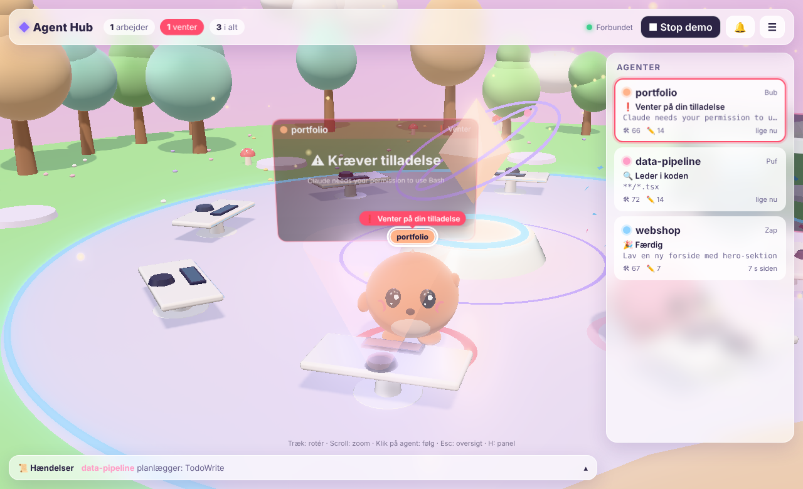

# ◆ Agent Hub



Et 3D-dashboard der viser dine **Claude Code-agenter** som nuttede væsner på en svævende ø.
Hver Claude Code-session bliver til en agent, der går hen til sin arbejdsstation i hubben og
koder, læser, kører kommandoer eller søger på nettet – i realtid. Når en agent **venter på dig**,
hopper og vinker den, og du får en lyd og en notifikation.

## Kom i gang (Windows)

**Krav:** Python 3.10–3.13 fra [python.org](https://www.python.org/downloads/) (sæt flueben i *"Add python.exe to PATH"*) og Claude Code installeret lokalt.

1. Hent repoet (fx med GitHub Desktop eller `git clone`), og åbn mappen.
2. **Dobbeltklik `start.bat`.** Første gang installeres alt automatisk (1–2 min.). Herefter åbner Agent Hub i sit eget vindue.
3. Klik **▶ Demo** for at se det i aktion uden Claude Code.
4. **Dobbeltklik `install_hooks.bat`** (én gang). Det kobler Claude Code til Agent Hub for *alle* dine projekter.
5. Genstart dine Claude Code-sessioner. Så dukker de op som agenter.

Fjern koblingen igen med `uninstall_hooks.bat`.

> Hvis Agent Hub ikke kører, mens du bruger Claude Code, sker der intet. Hook-scriptet giver op efter under ét sekund og blokerer aldrig Claude Code.

## Hvad betyder animationerne?

| Claude Code gør | Agenten | Skærmen |
|---|---|---|
| Får en opgave | går til sin station og tænker 💭 | tankebølger + opgaven |
| `Edit` / `Write` | taster løs ⌨️ | kode der skrives |
| `Bash` | taster ⌨️ | terminal + kommando |
| `Read` | læser i en bog 📖 | dokument der scannes |
| `Grep` / `Glob` | kigger gennem lup 🔍 | søgeresultater |
| `WebSearch` / `WebFetch` | kigger gennem lup 🌐 | søgefelt + resultater |
| `TodoWrite` | skriver på clipboard 📋 | tjekliste |
| `Task` / `Agent` (subagent) | dirigerer, små hjælpere kredser 🐣 | netværk af hjælpere |
| **Venter på tilladelse** | hopper og vinker ❗ (rød ring) | rød advarsel |
| Venter på dit svar | vinker 💬 (gul ring) | gul besked |
| Færdig | hopper af glæde 🎉 og går hjem | grønt flueben |
| 10 min uden aktivitet | sover 💤 | slukket |

**Styring:** træk = rotér · scroll = zoom · klik på agent eller kort = følg · `Esc` = oversigt · `H` = skjul panel.

## Arkitektur

```
Claude Code ──hook (JSON på stdin)──► hooks/agenthub_hook.py ──HTTP POST──► agenthub/server.py
                                         (kun stdlib, <0,1 s)                (FastAPI, 127.0.0.1:8765)
                                                                                   │ WebSocket
                                                                                   ▼
                                                              agenthub/web  (Three.js i pywebview-vindue)
```

| Fil | Ansvar |
|---|---|
| `agenthub/state.py` | Tilstandsmaskine: hook-hændelser → agent-aktiviteter. Ingen web-afhængigheder, fuldt testet. |
| `agenthub/server.py` | Modtager hændelser, streamer opdateringer via WebSocket, serverer frontend. |
| `agenthub/__main__.py` | Starter server + vindue (pywebview → Edge app-tilstand → browser). |
| `agenthub/install.py` | Fletter hooks sikkert ind i `~/.claude/settings.json` (backup, idempotent). |
| `agenthub/demo.py` | Simulerede sessioner til demo og test. |
| `hooks/agenthub_hook.py` | Selve hooket. Kun standardbibliotek, fejler aldrig. |
| `agenthub/web/js/` | 3D: `world.js` (ø, hub, stationer), `creature.js` (væsner), `screens.js` (hologrammer), `agents.js` (styring), `ui.js` (panel). |

Three.js (MIT) ligger lokalt i `agenthub/web/vendor`, så alt kører offline.

## Indstillinger

* **Port:** sæt `AGENTHUB_PORT` (både for app og hooks), standard `8765`.
* **Svag grafik?** Åbn med `?quality=low` (`http://127.0.0.1:8765/?quality=low`).
* **Kun browser:** `start.bat --browser` · **kun server:** `start.bat --server-only` · **demo ved start:** `start.bat --demo`.

## Kendte begrænsninger

* Hver hook-kørsel starter Python (~50–150 ms pr. værktøjskald på Windows).
* Op til 8 agenter får en station. Flere står i en ydre ring.
* Hvis du flytter mappen, skal du køre `install_hooks.bat` igen, fordi stien gemmes i hook-kommandoen.
* Claude Code-sessioner i skyen (claude.ai/code) kan ikke nå `127.0.0.1` på din PC. Kun lokale sessioner vises.

## Udvikling

```bash
pip install -r requirements-dev.txt
python -m pytest -q
python -m agenthub --demo
```
